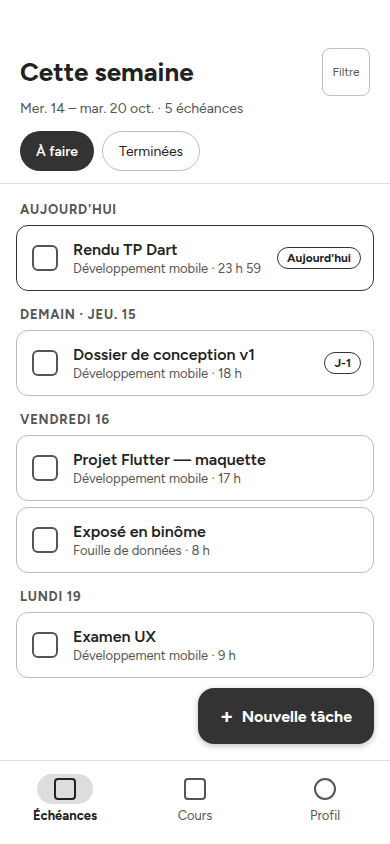
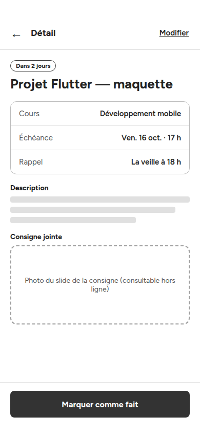

# Séance 2 : UX/UI et Claude Design, dossier de conception v1

Le dossier a été conçu dans Claude Design (canevas « CampusFlow, Dossier de conception v1 ») :
https://claude.ai/artifact/H4TLqVRGjYeSzu3N83W3xS

Chaque planche est exportée ici en image (`images/`). Le code HTML source de chaque planche se trouve dans `sources/` et s'ouvre directement dans un navigateur.

| Demandé par le sujet | Fichier |
|---|---|
| Persona et deux job stories (« Quand… je veux… pour… ») | [01_persona_job_stories.png](images/01_persona_job_stories.png) |
| Parcours « suivre mes échéances » en cinq étapes (action, friction, opportunité) | [02_parcours.png](images/02_parcours.png) |
| Cinq wireframes | [W1 Connexion](images/03_wireframe_W1_connexion.png), [W2 Échéances](images/03_wireframe_W2_echeances.png), [W3 Détail](images/03_wireframe_W3_detail.png), [W4 Nouvelle tâche](images/03_wireframe_W4_nouvelle_tache.png), [W5 Cours](images/03_wireframe_W5_cours.png) |
| Trois variantes d'un écran (Échéances) | [A Liste par jour](images/04_variante_A_par_jour.png), [B Groupée par cours](images/04_variante_B_par_cours.png), [C Bandeau semaine](images/04_variante_C_semaine.png) |
| Choix justifié avec la grille du cours (besoin, parcours, accessibilité, faisabilité) | [05_choix_justifie.png](images/05_choix_justifie.png) : la variante A est retenue (5 critères sur 5) |
| Design system v1 : couleurs, typographie, trois composants, tailles de fenêtre, contraste de 4,5:1 au minimum | [06_design_system_v1.png](images/06_design_system_v1.png) |

En plus de ce que demande le sujet :

- le logo « C-coche » : [07_logo.png](images/07_logo.png) ;
- la maquette haute fidélité des cinq écrans (H1 à H5, `08_*`) et des trois variantes (`09_*`), avec un choix justifié (`10_*`).

## Aperçu

| Persona | Parcours |
|---|---|
|  |  |

| W1 | W2 | W3 | W4 | W5 |
|---|---|---|---|---|
|  |  |  |  |  |

| Variante A (retenue) | Variante B | Variante C |
|---|---|---|
|  |  |  |

## Du design au code

La séance 4 reprend dans `lib/core/theme.dart` les tokens de la planche 6 :

- bleu campus `#2E3A8C` ;
- couleurs « urgent » et « terminé » ;
- police Figtree ;
- espacements.

Les écrans des séances 5 à 7 suivent les maquettes H1 à H5.
