# Séance 2 : UX/UI et Claude Design, dossier de conception v1

Le dossier a été conçu dans Claude Design (canevas « CampusFlow, Dossier de conception v1 ») :
https://claude.ai/artifact/H4TLqVRGjYeSzu3N83W3xS

Chaque planche est exportée ici en image (`images/`). Le code HTML source de chaque planche se trouve dans `sources/` et s'ouvre directement dans un navigateur. Dans les deux dossiers, les fichiers sont numérotés pour que la maquette haute fidélité vienne en premier (`01_` à `03_`).

## Maquette haute fidélité

Les cinq écrans de CampusFlow, en couleur, avec le design system v1 appliqué (tokens, police Figtree, composants). Ce sont ces écrans que l'application Flutter reproduit aux séances 4 à 7.

| Maquette haute fidélité | Fichier |
|---|---|
| Cinq écrans | [H1 Connexion](images/01_maquette_H1_connexion.png), [H2 Échéances](images/01_maquette_H2_echeances.png), [H3 Détail](images/01_maquette_H3_detail.png), [H4 Nouvelle tâche](images/01_maquette_H4_nouvelle_tache.png), [H5 Cours](images/01_maquette_H5_cours.png) |
| Trois variantes de l'écran Échéances | [A Liste par jour](images/02_maquette_variante_A.png), [B Groupée par cours](images/02_maquette_variante_B.png), [C Bandeau semaine](images/02_maquette_variante_C.png) |
| Choix justifié après la haute fidélité | [03_maquette_choix_justifie.png](images/03_maquette_choix_justifie.png) : la variante A reste retenue (5 critères sur 5, contre 3 pour B et 0 pour C) |

## Livrables demandés par le sujet

| Demandé par le sujet | Fichier |
|---|---|
| Persona et deux job stories (« Quand… je veux… pour… ») | [04_persona_job_stories.png](images/04_persona_job_stories.png) |
| Parcours « suivre mes échéances » en cinq étapes (action, friction, opportunité) | [05_parcours.png](images/05_parcours.png) |
| Cinq wireframes | [W1 Connexion](images/06_wireframe_W1_connexion.png), [W2 Échéances](images/06_wireframe_W2_echeances.png), [W3 Détail](images/06_wireframe_W3_detail.png), [W4 Nouvelle tâche](images/06_wireframe_W4_nouvelle_tache.png), [W5 Cours](images/06_wireframe_W5_cours.png) |
| Trois variantes d'un écran (Échéances) | [A Liste par jour](images/07_variante_A_par_jour.png), [B Groupée par cours](images/07_variante_B_par_cours.png), [C Bandeau semaine](images/07_variante_C_semaine.png) |
| Choix justifié avec la grille du cours (besoin, parcours, accessibilité, faisabilité) | [08_choix_justifie.png](images/08_choix_justifie.png) : la variante A est retenue (5 critères sur 5) |
| Design system v1 : couleurs, typographie, trois composants, tailles de fenêtre, contraste de 4,5:1 au minimum | [09_design_system_v1.png](images/09_design_system_v1.png) |

En plus : le logo « C-coche » ([10_logo.png](images/10_logo.png)).

## Aperçu

### Maquette haute fidélité : les cinq écrans

| H1 Connexion | H2 Échéances | H3 Détail | H4 Nouvelle tâche | H5 Cours |
|---|---|---|---|---|
| 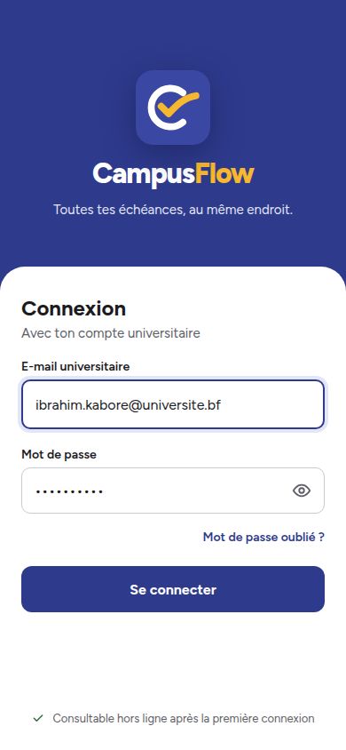 | 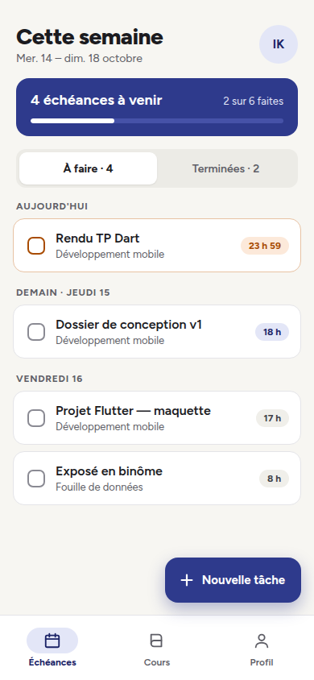 | 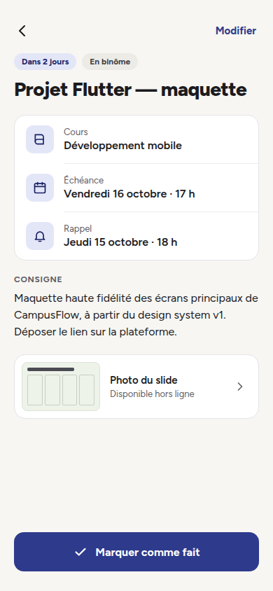 | 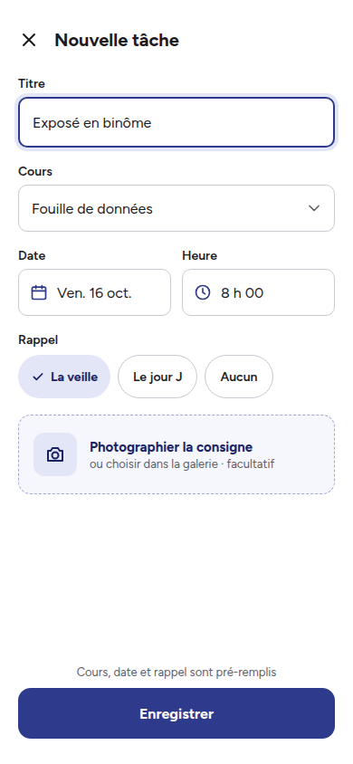 | 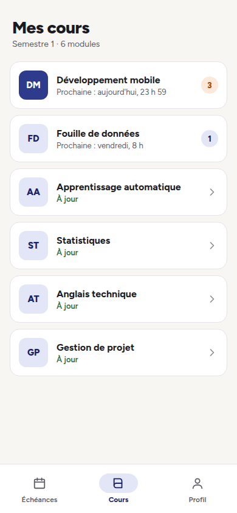 |

### Maquette haute fidélité : les trois variantes de l'écran Échéances

| A Liste par jour (retenue) | B Groupée par cours | C Bandeau semaine |
|---|---|---|
|  | 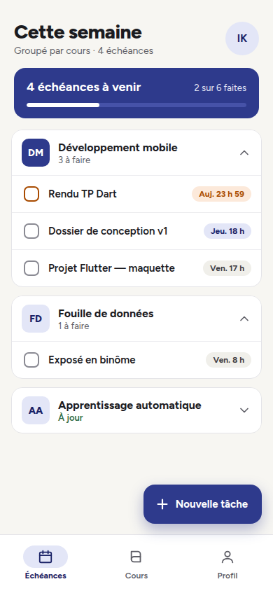 | 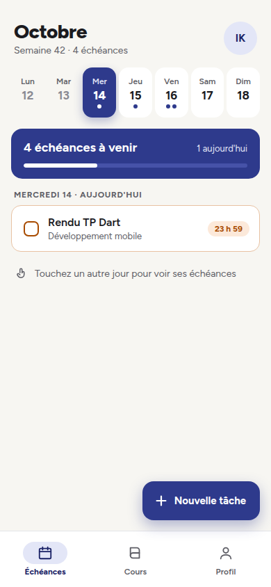 |

### Maquette haute fidélité : le choix justifié

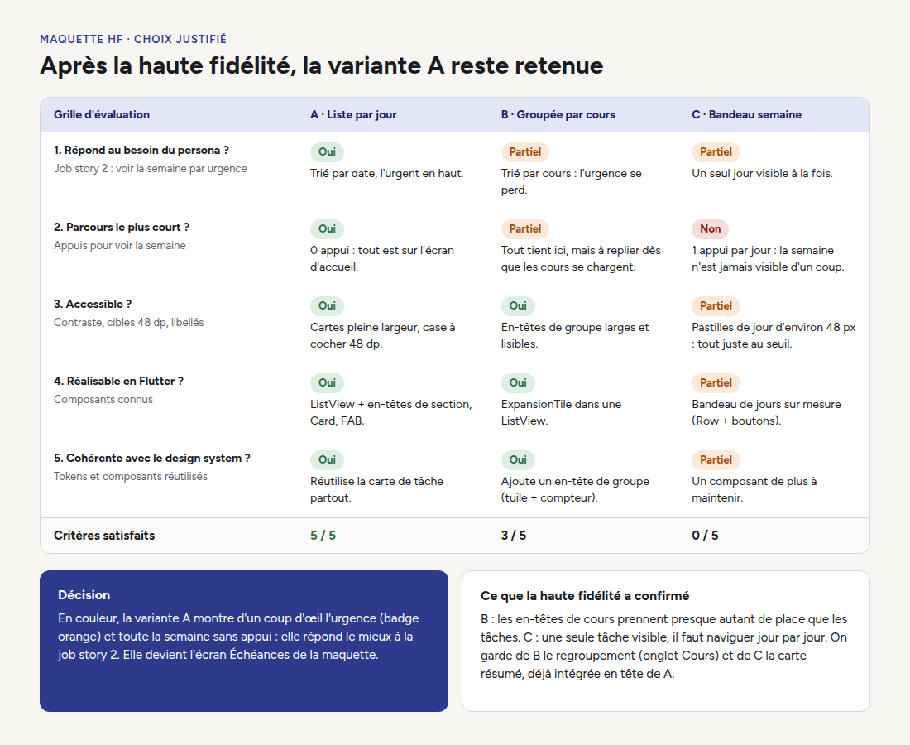

### Persona et parcours

| Persona | Parcours |
|---|---|
| 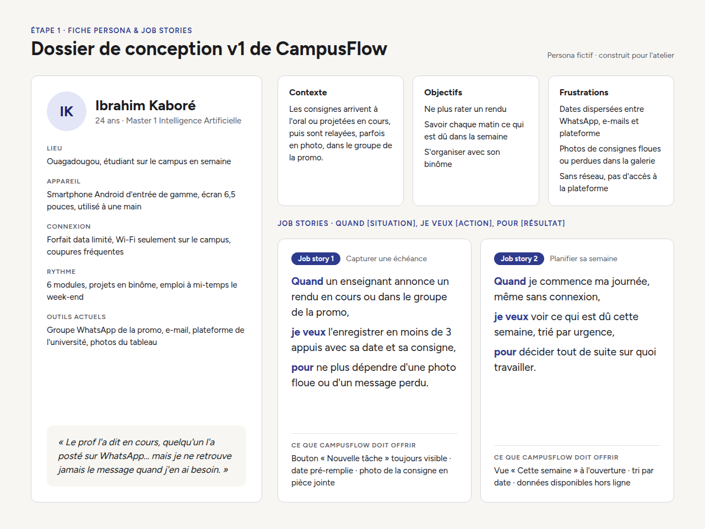 | 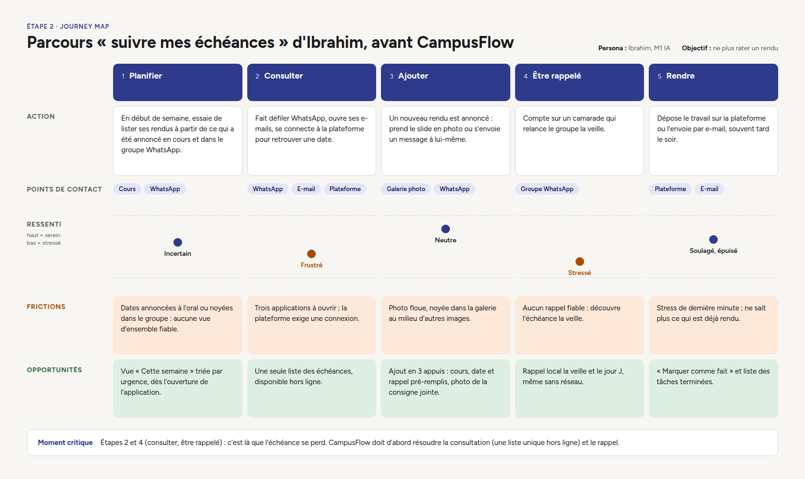 |

### Wireframes

| W1 | W2 | W3 | W4 | W5 |
|---|---|---|---|---|
| 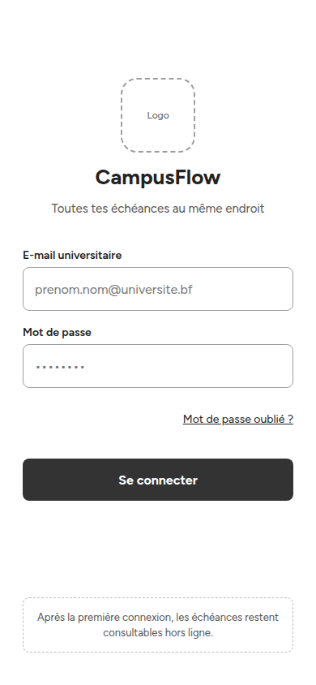 |  |  | 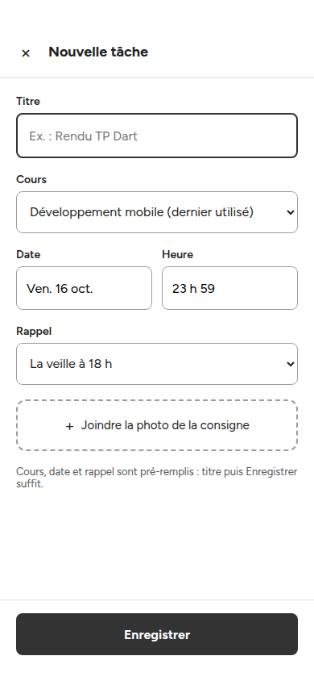 | 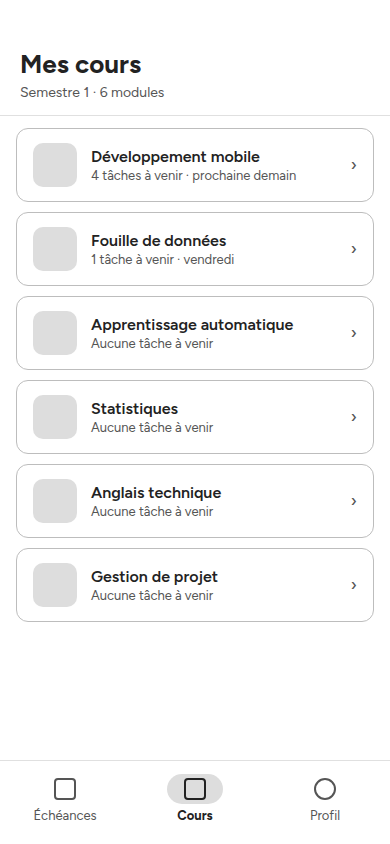 |

### Variantes en wireframe

| Variante A (retenue) | Variante B | Variante C |
|---|---|---|
| 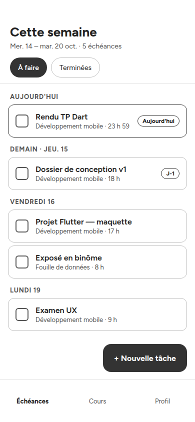 | 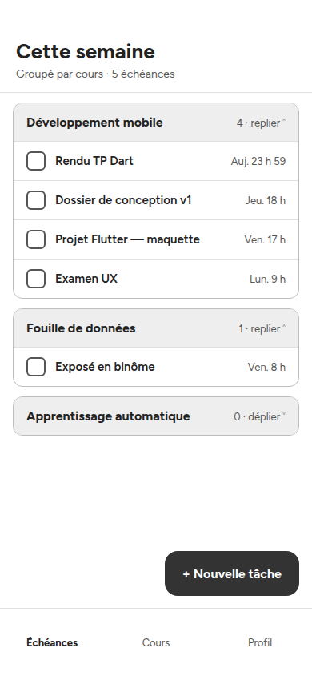 | 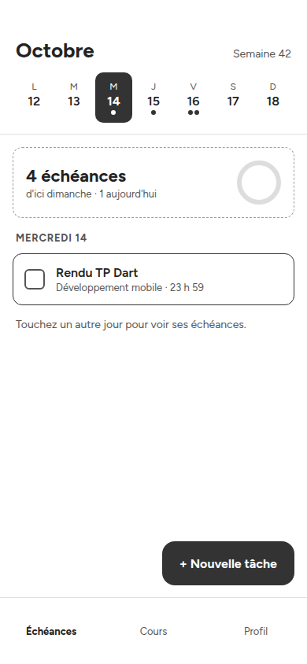 |

### Design system v1

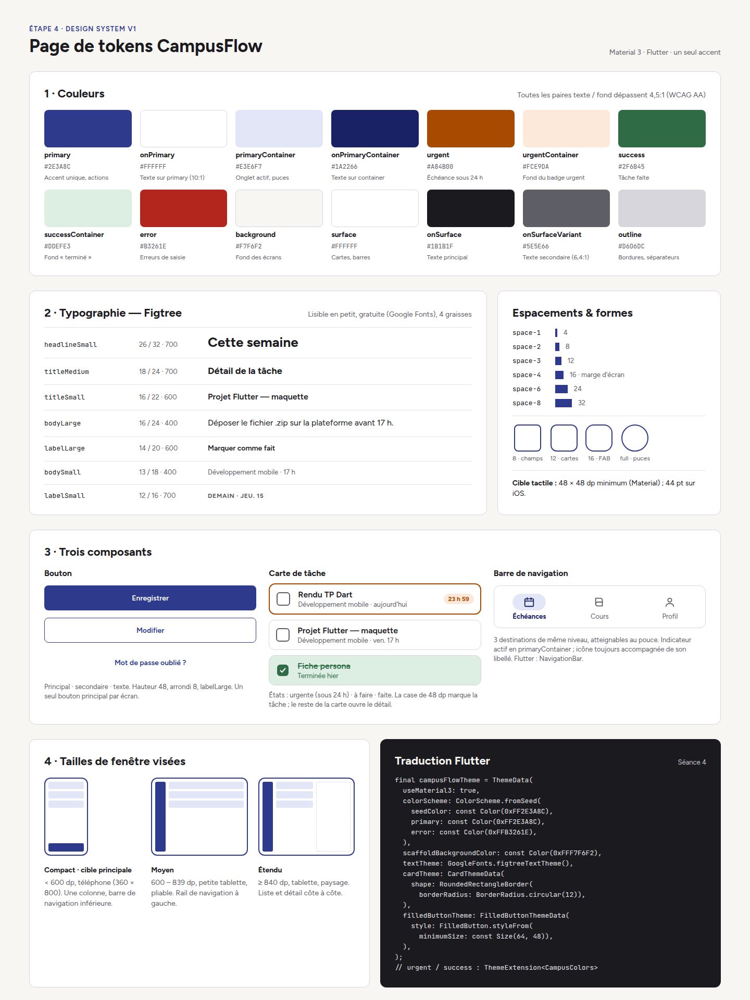

## Du design au code

La séance 4 reprend dans `lib/core/theme.dart` les tokens du design system v1 (`09_design_system_v1.png`) :

- bleu campus `#2E3A8C` ;
- couleurs « urgent » et « terminé » ;
- police Figtree ;
- espacements.

Les écrans des séances 5 à 7 suivent les maquettes H1 à H5.
